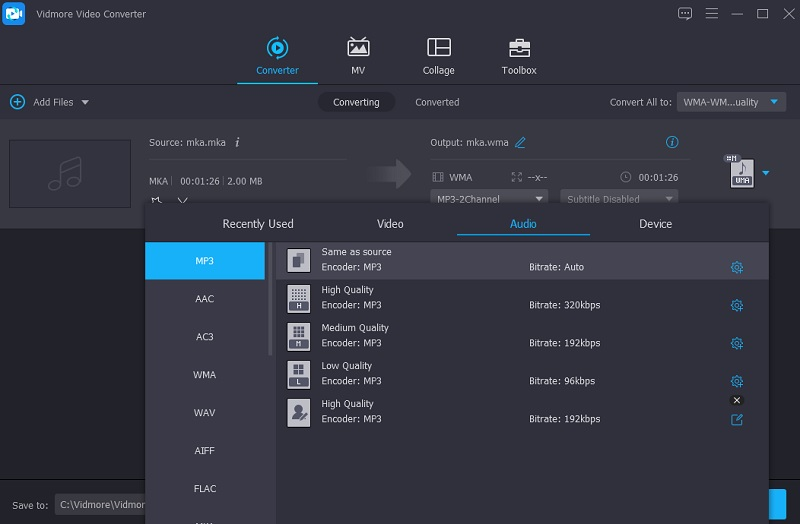
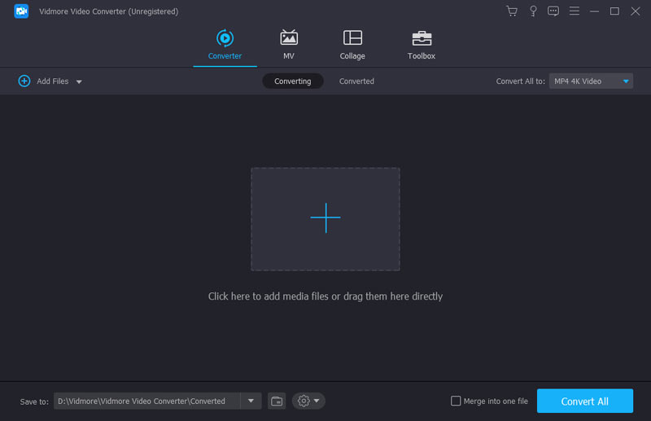
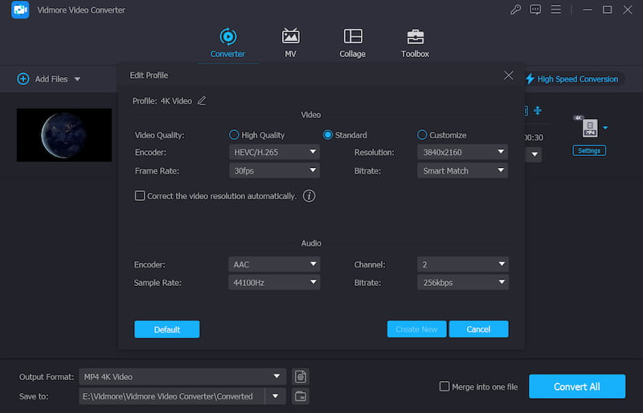

# Vidmore Video Converter, from Clips to Compositions

Turn a folder of recordings into a short sequence, a split-screen comparison, or a smaller viewing copy.
Vidmore Video Converter combines conversion with MV and collage tools, so the intended presentation can guide the export.

[](https://vidmore-converter.github.io/Vidmore-Video-Converter/)

## Arrange a sequence or share the frame

Choose whether the audience should see clips one after another or together.
That decision changes both the composition and the amount of detail available to each source.

### A sequence with a beginning and an ending

The MV workspace supports arranging clips, selecting a theme, and adding opening and closing titles.
Use the order to explain an event rather than relying on filenames to provide the story.

- Open with the scene that establishes context.
- Remove repeated actions that add no information.
- Keep related shots close together.
- Leave enough time for any title to be read.
- End on an image that makes the sequence feel complete.

Preview the transitions between clips as carefully as the clips themselves.
A good individual shot can still interrupt the rhythm of the sequence.

### Several views in one composition

The Collage workspace offers layouts for combining video and image sources.
Adjust the layout and borders before making detailed decisions about text placement.

A side-by-side comparison works best when the subjects occupy similar positions.
For demonstrations, keep the important action away from the dividing line.

JPEG assets can also introduce visible compression artifacts before video encoding begins.
The HandBrake reference pair for libjpeg-turbo, [module.defs](contrib/libjpeg-turbo/module.defs) and [module.rules](contrib/libjpeg-turbo/module.rules), documents a JPEG dependency and its build integration.



## Let the soundtrack support the picture

Vidmore can convert audio files and extract sound from video.
Its MV and collage workflows also provide choices for original sound and background music.

Listen to a passage containing speech before accepting the music level.
A soundtrack that sounds balanced during a quiet opening may obscure the main explanation.

For clips recorded in different locations, review changes in loudness at every cut.
Keep deliberate silence where it helps the audience understand a pause or transition.

### Audio references by role

The supplied HandBrake dependency pairs make several audio roles easier to distinguish:

- AAC: [module.defs](contrib/fdk-aac/module.defs) identifies the FDK AAC dependency; [module.rules](contrib/fdk-aac/module.rules) connects its build rules.
- MP3: [module.defs](contrib/lame/module.defs) defines LAME settings; [module.rules](contrib/lame/module.rules) imports the associated rules.
- Opus: [module.defs](contrib/libopus/module.defs) declares libopus; [module.rules](contrib/libopus/module.rules) integrates its build.
- Speech coding: [module.defs](contrib/libspeex/module.defs) defines Speex and its Ogg dependency; [module.rules](contrib/libspeex/module.rules) imports its rules.
- Container support: [module.defs](contrib/libogg/module.defs) declares libogg; [module.rules](contrib/libogg/module.rules) provides build integration.

An audio codec and a container solve different problems.
Choose an output format that the receiving player understands, then check the actual exported soundtrack.

## Keep captions readable inside the composition

A caption must remain legible after resizing and compression.
Review it against both a bright scene and a dark scene.

Avoid placing essential text at the extreme edges of a frame.
In a collage, check the final combined image rather than judging a caption only in the source clip.

Subtitle rendering involves more than loading characters from a file.
The companion references separate several parts of that work:

| Rendering concern | Dependency reference | Build reference |
| --- | --- | --- |
| Styled subtitle rendering | libass [module.defs](contrib/libass/module.defs) | [module.rules](contrib/libass/module.rules) |
| Font rasterization | FreeType [module.defs](contrib/freetype/module.defs) | [module.rules](contrib/freetype/module.rules) |
| Text shaping | HarfBuzz [module.defs](contrib/harfbuzz/module.defs) | [module.rules](contrib/harfbuzz/module.rules) |
| Bidirectional text handling | FriBidi [module.defs](contrib/fribidi/module.defs) | [module.rules](contrib/fribidi/module.rules) |

These roles help explain why a font change can affect spacing and line breaks.
Inspect names, punctuation, and mixed writing directions in the exported result.

If the audience needs selectable subtitles, confirm that the chosen output preserves that behavior.
Text drawn into the picture becomes part of the image and cannot be switched off by the viewer.



## Choose a short passage for export decisions

Before committing to a long render, select a passage that contains the hardest material.
Movement, foliage, screen text, and low-light scenes reveal different compression weaknesses.

Use the same source passage when comparing settings.
Otherwise, a simpler scene can make an unsuitable profile appear better than it is.

### Make an independent SDR comparison clip

This FFmpeg example creates a twenty-second review clip starting at one minute.
It encodes the first video stream and includes the first audio stream when available.

```bash
ffmpeg -n -ss 00:01:00 -i "source.mp4" -t 20 \
  -map 0:v:0 -map 0:a:0? -c:v libx264 -crf 22 \
  -pix_fmt yuv420p -c:a aac -b:a 160k "comparison-20s.mp4"
```

The example requires an FFmpeg build with libx264 and assumes an SDR source.
It re-encodes the selected passage and omits subtitles and additional tracks.
Keep the source when preparing a separate preservation copy.

Judge the exported clip at the size at which it will normally be viewed.
Then inspect a few difficult frames more closely.

- Look for broken edges around moving objects.
- Check whether small labels remain readable.
- Listen for changes around cuts.
- Confirm that the last frame and final word are present.
- Try playback in the intended receiving application.

## Separate compression from processing capability

A smaller file can come from lower bitrate, reduced dimensions, shorter duration, or a different codec.
These changes have different consequences for the viewer.

Vidmore's Video Compressor exposes size, format, resolution, and bitrate controls.
Use a preview to evaluate the tradeoff before processing a longer source.

Hardware acceleration also depends on the available hardware and the selected operation.
A faster export does not by itself establish equivalent visual quality.

### Four components worth distinguishing

The accompanying HandBrake material provides concrete examples of media-processing components.
Its dependency files describe the named projects rather than the controls shown in Vidmore.

| Component | Role in a media pipeline | Definition and build references |
| --- | --- | --- |
| FFmpeg | Media decoding, encoding, and format handling | [module.defs](contrib/ffmpeg/module.defs), [module.rules](contrib/ffmpeg/module.rules) |
| AMD AMF headers | Interface declarations for AMD media processing | [module.defs](contrib/amf/module.defs), [module.rules](contrib/amf/module.rules) |
| dav1d | AV1 decoding | [module.defs](contrib/libdav1d/module.defs), [module.rules](contrib/libdav1d/module.rules) |
| libdovi | Dolby Vision metadata processing | [module.defs](contrib/libdovi/module.defs), [module.rules](contrib/libdovi/module.rules) |

A decoder lets software read a compressed stream.
It does not automatically provide an encoder for writing the same format.

HDR metadata introduces another set of requirements.
A profile name alone does not establish that the output preserves the source's HDR behavior.

## Keep a batch tied to a written delivery plan

Vidmore's conversion workflow accepts multiple files and offers a merge option.
Decide whether the result should contain individual clips or one combined output before starting the batch.

For separate deliverables, use names that distinguish the destination and the revision.
Avoid placing finished files where they can be confused with the original recordings.

### Record the editorial decisions

This Python example creates a small CSV handoff sheet for two planned outputs.
It records decisions for a person to apply in the GUI.

```python
import csv
jobs = [
    ("interview.mp4", "Interview review", "Keep speech; omit music"),
    ("demo.mp4", "Side-by-side demonstration", "Check labels at final size"),
]
with open("delivery-plan.csv", "x", newline="", encoding="utf-8") as output:
    writer = csv.writer(output)
    writer.writerow(["source", "deliverable", "review_note"])
    writer.writerows(jobs)
```

The CSV is a human-readable planning sheet, not a Vidmore import preset.
Add the exact export settings to the same review record after approving a trial render.

Structured settings often use a different representation.
The Jansson pair, [module.defs](contrib/jansson/module.defs) and [module.rules](contrib/jansson/module.rules), documents a JSON library in the supporting HandBrake material.

### Complete the batch with a receiving-side check

Open one output from every distinct profile or composition type.
A successful render is only the first part of delivery.

1. Confirm that the file opens in the receiving player.
2. Check the beginning and end.
3. Listen to the selected soundtrack.
4. Review titles and captions.
5. Confirm whether files were merged as intended.
6. Compare the result with the written delivery plan.



Version changes can affect how a previously successful workflow behaves.
[NEWS.markdown](NEWS.markdown) records HandBrake changes and upgrade notes for the supplied references.
Read [LICENSE](LICENSE) for the licensing context of that supporting collection.

Vidmore Player and Vidmore Screen Recorder are separate products in the same catalog.
Use their names to identify playback and capture workflows rather than treating those features as converter commands.
The broader phrase Vidmore Converter refers here to the Vidmore Video Converter workflow described above.

## Related Search Terms

Vidmore Converter, Vidmore Video Converter, vidmore player, vidmore screen recorder, vidmore video editor, video-converter, video-transcoding, video-processing, video-editing, ffmpeg, multimedia, audio, video, mp4, collage
